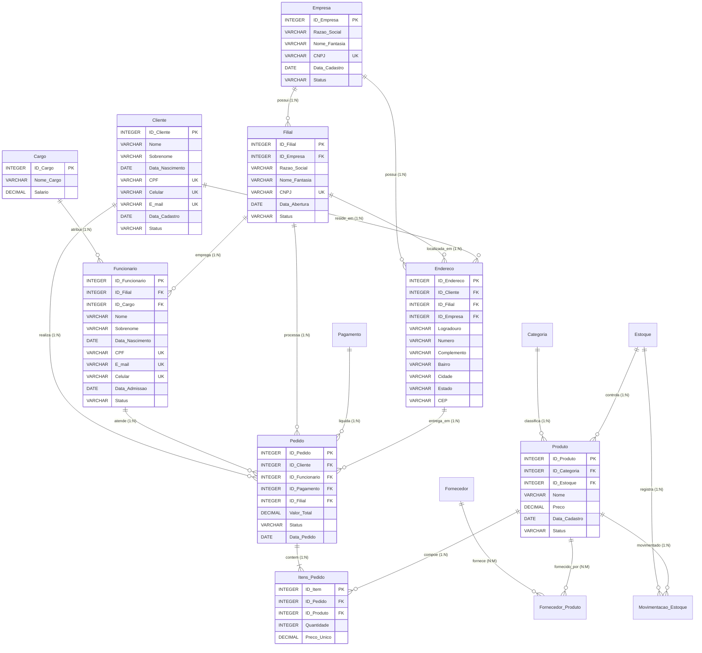

# 🏪 Sistema Comercial e Franquias - Banco de Dados PostgreSQL na AWS RDS

[](https://www.postgresql.org/)
[](https://aws.amazon.com/rds/)
[](https://www.pgadmin.org/)
[]()

> Projeto de modelagem de dados relacional e implantação em nuvem gerenciada (AWS RDS PostgreSQL), contemplando Modelo Conceitual/Lógico, Modelo Físico DDL completo com regras de integridade (Constraints e Regex), inserção de dados e consultas analíticas para o sistema comercial **Pastelaria BB / Sistema Empresarial**.

---

## 📌 Sumário
- [Visão Geral do Sistema](#-visão-geral-do-sistema)
- [Diagrama Entidade-Relacionamento (DER / Modelo Lógico)](#-diagrama-entidade-relacionamento-der--modelo-lógico)
- [Estrutura do Modelo e Regras de Negócio](#-estrutura-do-modelo-e-regras-de-negócio)
- [Implantação na Nuvem (AWS RDS) - Evidências e Passo a Passo](#-implantação-na-nuvem-aws-rds---evidências-e-passo-a-passo)
- [Estrutura do Repositório](#-estrutura-do-repositório)
- [Como Reproduzir a Conexão](#-como-reproduzir-a-conexão)

---

## 🎯 Visão Geral do Sistema

O banco de dados foi projetado para gerenciar operações completas de uma rede comercial com matriz e filiais, estruturado nos seguintes módulos:
* **Corporativo:** Gestão de Matriz (`Empresa`), `Filial` e `Endereco` polimórfico exclusivo.
* **Recursos Humanos:** `Cargo` (com validação salarial) e `Funcionario` vinculados à filial.
* **Clientes & Atendimento:** `Cliente` (com validação estrita de CPF por Regex e contatos únicos).
* **Catálogo & Estoque:** `Categoria`, `Produto`, `Estoque`, `Fornecedor`, relacionamento N:M (`Fornecedor_Produto`) e rastreamento de `Movimentacao_Estoque`.
* **Vendas & Finanças:** `Pedido`, itens de pedido (`Itens_Pedido`) e `Pagamento`.

---

## 📊 Diagrama Entidade-Relacionamento (DER / Modelo Lógico)

O diagrama abaixo representa as entidades, atributos-chave e cardinalidades do sistema:



---

## 🔒 Estrutura do Modelo e Regras de Negócio

O modelo físico foi construído no PostgreSQL aplicando padrões avançados de integridade:
* **Identificadores Automáticos:** Utilização da sintaxe padrão SQL/PostgreSQL `GENERATED BY DEFAULT AS IDENTITY`.
* **Validação de Endereço Exclusivo:** Função `num_nonnulls(ID_Cliente, ID_Filial, ID_Empresa) = 1` garantindo que cada registro de endereço pertença a exatamente uma entidade.
* **Validação de CPF por Expressão Regular (Regex):** `CHECK (CPF ~ '^[0-9]{11}$')`.
* **Validação de E-mail:** `CHECK (E_mail IS NULL OR E_mail ~ '^[A-Za-z0-9._%+-]+@[A-Za-z0-9.-]+\.[A-Za-z]{2,}$')`.
* **Restrições de Domínio e Valores:** Verificações `CHECK` para impedir valores negativos em preços, salários e quantidades (`CHECK (Preco >= 0)`, `CHECK (Salario >= 0)`).

---

## ☁️ Implantação na Nuvem (AWS RDS) - Evidências e Passo a Passo

O banco de dados foi hospedado em um ambiente gerenciado na nuvem Amazon Web Services (AWS) utilizando o **Amazon RDS (Relational Database Service)**.

### 1. Configuração do Mecanismo e Criação do Banco
Configuração do banco de dados escolhendo o motor **PostgreSQL** com método de configuração completa elegível para a camada gratuita (*Free Tier*).


---

### 2. Configuração de Rede e Segurança (Security Group)
Criação do Grupo de Segurança da VPC (`My-Security-Group`) com regra de entrada (*Inbound Rule*) liberando a porta padrão do PostgreSQL (**5432**) via protocolo TCP.


---

### 3. Instância Criada e Disponível na AWS
Instância `database-aws` ativa com status verde **Disponível**, classe `db.t4g.micro`, região `us-east-1` e usuário principal `PostgreAWS`.


---

### 4. Conexão Externa via pgAdmin 4
Conexão cliente realizada com sucesso conectando o **pgAdmin 4** diretamente ao Endpoint público da AWS RDS através de túnel criptografado SSL.


---

### 5. Execução do Script DDL e Criação das Tabelas
Execução do script de modelo físico através do Query Tool do pgAdmin no banco remoto da AWS, criando todas as tabelas, chaves primárias, estrangeiras e constraints.


---

### 6. Validação e Listagem das Tabelas no Schema Public
Consulta ao catálogo do PostgreSQL (`pg_tables`) confirmando a criação com sucesso de todas as 15 tabelas do sistema na nuvem AWS.


---

### 7. Inserção e Consulta de Dados Reais
Consulta analítica (`SELECT * FROM empresa;`) comprovando o armazenamento, persistência e leitura de dados ativos no PostgreSQL hospedado na AWS RDS.


---

## 📁 Estrutura do Repositório

```text
├── docs/
│   └── modelo_fisico.html                               # Documentação interativa, responsiva e DER
├── prints/
│   ├── 01_criacao_rds_postgresql.png                    # Configuração da engine no RDS
│   ├── 02_security_group_porta_5432.png                 # Regra de firewall AWS
│   ├── 03_rds_disponivel_status.png                     # Status e resumo da instância
│   ├── 04_pgadmin_servidor_conectado.png                # pgAdmin conectado ao RDS
│   ├── 05_query_tool_execucao_ddl.png                   # Script DDL executado
│   ├── 06_validacao_tabelas_criadas.png                 # Listagem das 15 tabelas no schema
│   └── 07_consulta_dados_empresa.png                    # Query SELECT com dados na AWS
├── sql/
│   └── modelo_fisico_postgresql.sql                     # Script SQL DDL, DML e Queries
├── .env.example                                         # Exemplo de configuração de conexão
├── .gitignore                                           # Arquivos ignorados pelo Git
└── README.md                                            # Documentação principal do projeto
```

---


---

*Projeto acadêmico/profissional desenvolvido para o curso de Análise e Desenvolvimento de Sistemas (ADS).*
